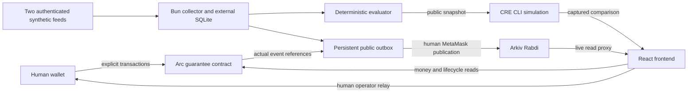

# Actual prototype architecture

6November2026. Deployed protocol v3 is on Arc Testnet. Frontend/service run locally; no public hosted candidate is verified.

Arc enforces frozen terms, cohort liability, verdict domain/nonce/expiry, full review, separate non-resetting uncertainty timeout and bounded payouts/refunds. Provider admission is distinct. Offchain feed failure cannot automatically open an onchain dispute. Unresolved finalization refunds escrow only, then unlocks bond. Terminal outcomes cannot be overwritten.

The collector authenticates two same-team sources and retains private envelopes/keys outside Git. Public receipts are hash-linked; the fixed deadline snapshot cannot be rewritten by late arrivals. Integrity is not truth, completeness or source independence.

CRE reuses the evaluator with actual chain/API reads. The app compares captured CLI results for an explicit trusted human relay. No live CRE network, DON authentication or continuous CRE execution is claimed. The receiver is tested but undeployed; current immutable EOA operator cannot be changed in place.

Arkiv holds evidence pages, manifest and Arc references. Reads check creator/owner, body/domain hashes, complete chain, outcome and Arc anchor. Attribute immutability does not prevent deletion/transfer/expiry. Local queue/locks protect ordinary retries, not cross-device onchain uniqueness.

Service127.0.0.1:8787 permits local app origins and keeps the access key server-side. RPC proxy refuses signing/broadcast and restricts call/estimate targets. Frontend5173. Public hosting requires reviewed HTTPS routing, persistent external storage and process supervision. Uploading only dist is insufficient; a sleeping laptop is not continuous monitoring.

Deployment helper is separate/local-only. Financial/version guards stay enabled. Studio parity and sponsor/judge access remain unresolved until actually verified.
